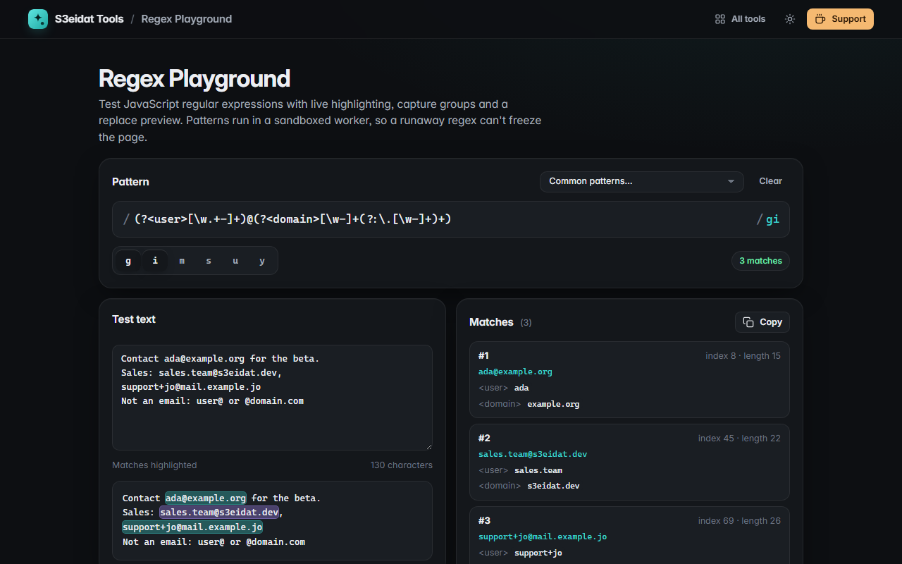

# Regex Playground

> Test JavaScript regular expressions with live highlighting, groups and a replace preview. Free, private, and it runs entirely in your browser.

### ▶ [Open Regex Playground](https://s3eidat.github.io/regex-playground/)



## Features

- Pattern editor with **flag toggles**: `g` `i` `m` `s` `u` `y`
- **Live highlighting** of every match in your test text (empty matches shown as a caret)
- **Match list** with index, length, numbered groups (`$1`, `$2`…) and **named groups** (`<year>`)
- **Replace preview** using JavaScript's own replacement syntax: `$1`, `$<name>`, `$&`, `` $` ``, `$'`
- **Common patterns**: email, URL, IPv4, ISO date with named groups, hex colour, duplicate words, Arabic words, …
- **Cheat sheet**: click any token to insert it at the cursor
- **Runaway-pattern guard**: the regex runs in a Web Worker that is stopped after 1.5 s, so catastrophic
  backtracking like `^(a+)+$` can't freeze the tab
- Copy all matches or the replaced text; your pattern and flags are remembered

It uses your browser's own JavaScript `RegExp` engine, so results match what your JS code will do.

## Privacy

Your patterns and text never leave your device. There is no server, no account, no analytics.
The page ships with a strict Content-Security-Policy (`connect-src 'self'`), so the browser
itself blocks any attempt to send data anywhere.

## Run it yourself

It's plain HTML, CSS and JavaScript with no build step:

```bash
git clone https://github.com/s3eidat/regex-playground
cd regex-playground
python -m http.server 8000
```

Then open http://localhost:8000.

## Support

If this saved you time, **[buy me a coffee ☕](https://s3eidat.github.io/coffee/)**. It keeps every tool free.

---

Part of **[S3eidat Tools](https://s3eidat.github.io/)**: 100+ free, private tools that run in your browser. MIT licensed.
